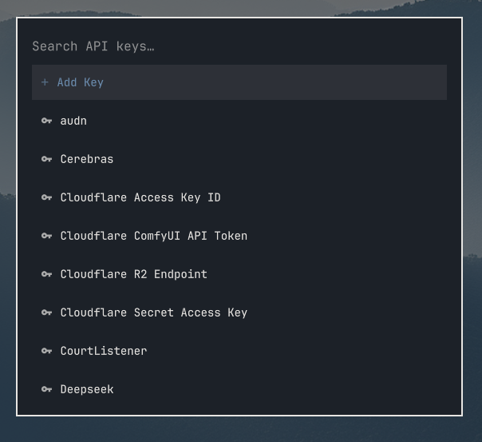

# omakeys

<p align="center">
  
</p>

A clipboard-history-style API key selector for [Omarchy](https://omarchy.org).
Press **Super + A**, type to filter, hit Enter — the key is on your clipboard.
Keys are stored encrypted in gnome-keyring, and copies are marked sensitive so
they stay out of clipboard history.

## Install

```bash
omarchy plugin add https://github.com/chrispository/omakeys.git --enable && ~/.config/omarchy/plugins/chrispository.omakeys/setup
```

Or from a clone: `git clone https://github.com/chrispository/omakeys.git && cd omakeys && ./install`.

Setup installs the `omakeys` CLI to `~/.local/bin/`, adds any missing
dependencies (`libsecret`, `wl-clipboard`, `wtype`), and binds **Super + A**
in `~/.config/hypr/bindings.lua` unless that chord is taken. To use a
different chord, edit the `o.bind("SUPER + A", ...)` line there.

## Use

| Key | Action |
| --- | --- |
| Type | Filter key names |
| **Enter** | Copy the selected key |
| **Shift + Enter** | Paste it into the focused window |
| **F2** | Rename the selected key |
| **Delete** | Delete the selected key (asks first) |
| **Ctrl + N** | Add a key (or press Enter on **＋ Add Key**) |
| **Esc** | Clear the filter, then close |

In the add and rename forms, **Enter** saves and **Esc** cancels. Saving or
renaming onto a name that already exists asks before replacing it — which is
also how you rotate a key: add it again under the same name.

### CLI

```bash
omakeys add <name>       # store a key (hidden prompt, or pipe the value in)
omakeys list             # list key names
omakeys copy <name>      # copy to clipboard
omakeys show <name>      # print to stdout
omakeys rm <name>        # delete
omakeys mv <old> <new>   # rename
omakeys import <file|->  # bulk import NAME=VALUE lines, then offers to shred the file
omakeys export           # print every key as NAME=VALUE
omakeys export --encrypt <file>   # gpg-encrypted backup
```

Restore a backup with `gpg -d keys.gpg | omakeys import -`.

## Security

Keys live in the gnome-keyring login collection (`service=api-keys`,
`name=<key name>`), encrypted at rest and unlocked with your login. The
overlay only ever lists names; copying pipes `secret-tool lookup` straight
into `wl-copy --sensitive`, and new values go to `secret-tool store` over
stdin, never argv.

The keyring is unlocked for your whole session, so this protects keys on a
stolen or backed-up disk, not from malware running as your user. If you want
a passphrase prompt on every use, use `pass` with GPG pinentry instead.

## Uninstall

```bash
~/.config/omarchy/plugins/chrispository.omakeys/uninstall
```

Removes the plugin, CLI, and keybinding. Stored keys stay in the keyring; the
script prints a one-liner to wipe them too.

## License

MIT — see [LICENSE](LICENSE).
